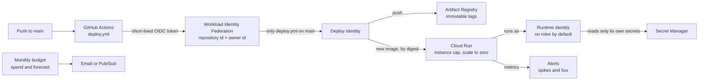

# terraform-google-secure-cloud-run

[](https://github.com/DarkkSorkk/terraform-google-secure-cloud-run/actions/workflows/ci.yml)

Terraform module for a Google Cloud Run service with the guards most services skip:

- the bill has a ceiling;
- the service has its own identity, with no roles;
- secrets never touch code or state;
- only one workflow, on `main`, can deploy, with no key stored anywhere.

> **Em português:** módulo Terraform para publicar um serviço no Cloud Run com a segurança e o custo sob controle desde o primeiro dia: teto de instâncias, identidade própria sem permissão nenhuma, segredos fora do código e do estado, e deploy pelo GitHub sem chave, só a partir da `main`. Mais sobre como trabalho com nuvem em [easyia.org/nuvem](https://easyia.org/nuvem).

## Why

A first Cloud Run deploy usually has four problems, and each one is a common source of incidents and surprise bills:

- it runs as the default compute account, which often holds the broad Editor role;
- it has no instance cap;
- it gets secrets as plain environment variables;
- it deploys from GitHub with a JSON key saved in the repository settings.

This module makes the safe choice the default, and rejects the unsafe ones before anything is created.

## What you get

| Risk | What the module does |
|---|---|
| Surprise bill from a spike or an attack | `max_instances` has **no default**: you must choose the ceiling. The service scales to zero and CPU is billed only during requests. Traffic above capacity gets HTTP 429 and is not billed. Alerts fire on request spikes. The `budget` submodule adds a monthly budget with alerts on actual and forecast spend. |
| Over-privileged service | Runs as its own service account with **zero roles**. `roles/owner`, `roles/editor` and `roles/viewer` are rejected at plan time. |
| Leaked secrets | Secret Manager. Each secret is created empty and its value is added with `gcloud`, so it never enters code or Terraform state. Only this service can read it. |
| Leaked deploy keys | No keys: Workload Identity Federation. The `github-oidc` submodule accepts tokens from **one repository, matched by numeric id** (a rename or a re-created repository with the same name does not get in). The deploy identity works only for **one workflow file on `main`**. It can push to one image repository and update one service, and `roles/run.developer` cannot change IAM, so a deploy can never make the service public. |
| Accidental exposure | Private by default. Public access is one explicit flag. |
| Accidental deletion | `deletion_protection` is on by default. |
| An image swapped under a tag | Immutable tags and deploys by digest. A cleanup policy keeps the newest images for rollbacks and deletes old ones. |
| A broken release nobody notices | Alert on bursts of HTTP 5xx, with the rollback command in the alert text. |

## How it fits together



## Usage

```hcl
module "api" {
  source = "github.com/DarkkSorkk/terraform-google-secure-cloud-run?ref=v0.1.0"

  project_id    = "my-project"
  region        = "southamerica-east1"
  name          = "api"
  max_instances = 3

  runtime_roles = ["roles/datastore.user"]           # only what the code calls
  secrets       = { DATABASE_URL = "api-database-url" } # value added with gcloud
}
```

Deploy access and the budget are separate submodules, so you can use only what you need:

```hcl
module "deploy" {
  source = "github.com/DarkkSorkk/terraform-google-secure-cloud-run//modules/github-oidc?ref=v0.1.0"

  project_id           = "my-project"
  github_repository    = "my-user/api"
  github_repository_id = "123456789" # gh api repos/my-user/api --jq .id
  github_owner_id      = "987654321" # gh api users/my-user --jq .id

  cloud_run_service            = { name = module.api.service_name, location = "southamerica-east1" }
  runtime_service_account_name = module.api.runtime_service_account_name
  artifact_repository          = { repository_id = module.api.artifact_repository_id, location = "southamerica-east1" }
}
```

## Full example

[`examples/hello`](examples/hello) builds a small public API with every guard on:

- the service;
- keyless deploys;
- email alerts;
- a monthly budget.

1. Copy `terraform.tfvars.example` to `terraform.tfvars` and fill it in. A new, empty project is best.
2. Run `terraform init`, then `terraform plan`. Read the plan, then run `terraform apply`.
3. In your own repository, copy the `app/` folder and [`.github/workflows/deploy.yml`](examples/hello/.github/workflows/deploy.yml). Create the repository variables listed by `terraform output github_actions_variables`. None of them is a secret.
4. Push to `main`. The workflow then:
   - tests the app;
   - builds the image, checks that it does not run as root and scans it with Trivy;
   - pushes the image and deploys it by digest.

An idle service scales to zero. You pay for requests while they run and for image storage.

## Adding a secret

A revision whose secret has no value does not start. That is on purpose: a service should never run with an empty secret. So the secret gets its value before the service uses it.

1. Add it to the module: `secrets = { API_TOKEN = "hello-api-token" }`.
2. Create only the secret:

   ```bash
   terraform apply -target='module.service.google_secret_manager_secret.this["API_TOKEN"]'
   ```

3. Add the value. It is typed in, so it stays out of files and shell history:

   ```bash
   read -rs VALUE && printf '%s' "$VALUE" | gcloud secrets versions add hello-api-token --data-file=- && unset VALUE
   ```

4. Run `terraform apply`. The service now reads the secret, and only the service can.

## Inputs

| Name | Default | What it is |
|---|---|---|
| `project_id` | required | Project of the service. |
| `region` | required | Region of the service, its secrets and its images. |
| `name` | required | Service name. It also names the image repository and the runtime identity. |
| `max_instances` | **required** | Ceiling for the whole service (1 to 100). This number is your worst-case bill. |
| `min_instances` | `0` | Warm instances. 0 means an idle service costs nothing. |
| `concurrency` | `10` | Requests at the same time per instance. |
| `timeout_seconds` | `60` | Maximum time for one request. |
| `cpu` / `memory` | `"1"` / `"512Mi"` | Limits per instance. |
| `allow_unauthenticated` | `false` | Let anyone on the internet call the service. |
| `ingress` | `INGRESS_TRAFFIC_ALL` | Where requests may come from. |
| `runtime_roles` | `[]` | Project roles for the service identity. Basic roles are rejected. |
| `env` | `{}` | Plain variables. Never secrets. |
| `secrets` | `{}` | `{ ENV_VAR = "secret-id" }`, read from Secret Manager. |
| `image` | Google's hello image | First image only. The deploy pipeline replaces it, and Terraform ignores that change. |
| `create_artifact_repository` | `true` | Docker repository with immutable tags and a cleanup policy. |
| `image_keep_count` / `image_retention_days` | `5` / `30` | Newest images kept for rollbacks. Older ones are deleted after this many days. |
| `deletion_protection` | `true` | Blocks deletion of the service. |
| `notification_channels` | `[]` | Alert channels. When the list is empty, no alert is created. |
| `alert_requests_per_5min` / `alert_5xx_per_5min` | `300` / `5` | Alert thresholds. Tune them to your traffic. |
| `labels` | `{}` | Added to every resource that supports labels. |

**Outputs:**
- `service_name`
- `service_uri`
- `runtime_service_account_email`
- `runtime_service_account_name`
- `artifact_repository_id`
- `image_path`
- `secret_ids`

The submodules document their own inputs in [`modules/github-oidc/variables.tf`](modules/github-oidc/variables.tf) and [`modules/budget/variables.tf`](modules/budget/variables.tf).

## Tests

```bash
terraform init -backend=false && terraform test
```

The 22 tests run against a **mocked Google provider**: no cloud account, no credentials, nothing created. They check two things:

- **Behavior:**
  - the service is private and capped by default;
  - it runs as its own identity;
  - a secret reaches only this service;
  - only `deploy.yml` on `main` can deploy.
- **Rejected input:**
  - basic roles;
  - an instance cap of 0;
  - a repository name where the numeric id belongs;
  - turning off the budget emails with no other channel.

CI runs on every push and pull request:
- `fmt`, `validate` and the tests;
- the example app's tests;
- a [Trivy](https://trivy.dev) scan for misconfigurations and leaked secrets.

None of these steps touches a cloud account.

## What it does not do

- **A budget is an alarm, not a cap.** Google keeps billing after 100%. The caps are `max_instances`, `concurrency` and scale to zero. For an automatic response, send the budget or the spike alert to Pub/Sub and act on it. One example is removing public access during an attack. If you automate that, manage public access outside Terraform, so that the next `apply` does not restore it.
- **No load balancer or edge protection.** Custom domains behind a load balancer, Cloud Armor and VPC connectors are out of scope.
- **The alert thresholds are starting points.** Set them a few times above your normal peak.

## In production

The same patterns run in production behind the contract-reading demo at [easyia.org/amostra/contrato](https://easyia.org/amostra/contrato). It is built with Python and RAG, runs on Cloud Run, and all of its infrastructure is in Terraform. How EasyIA builds and runs cloud infrastructure: [easyia.org/nuvem](https://easyia.org/nuvem).

## Author

Allan Felipe Silva, founder of [EasyIA](https://easyia.org). Built with AI-assisted development (Claude Code), with review and tests.

Licensed under [MIT](LICENSE).
